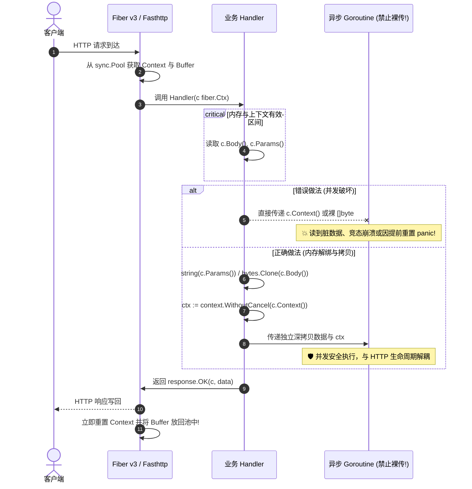
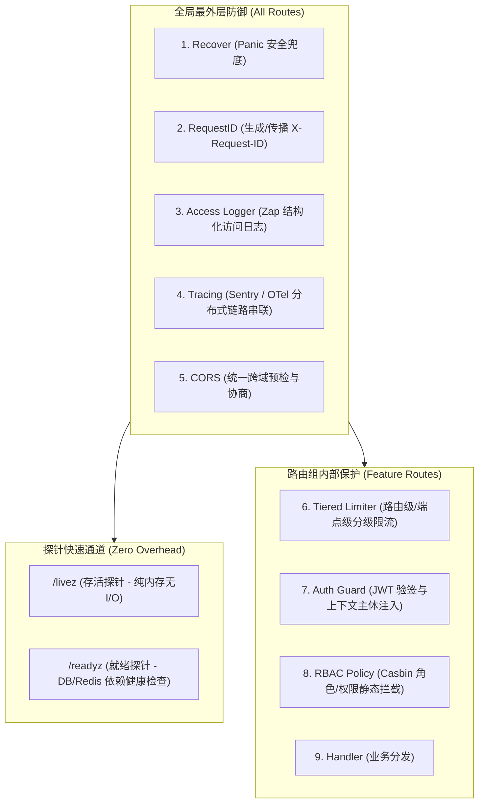

# Fiber v3 现代引擎与 Web 传输层规范 (Fiber v3 Architecture & Discipline)

本文档是 `bfiber` 仓库针对 **Go 1.27+** 与 **Fiber v3** 框架构建高并发 Web API 的专责规范。系统严格遵循**领域优先垂直切片架构 (Domain-First Vertical Slice)**，彻底杜绝 Fiber v2 废弃接口与传统水平分层的隐式耦合，确保极致吞吐、内存安全与严格契约一致性。

---

## 1. 核心定位与 Fiber v3 架构代差 (Core Principles & Evolution)

Fiber v3 相比 v2 在并发模型、类型系统与内存分配上发生了根本性演进。所有涉及 HTTP 传输层的开发必须严格遵守以下代差与选型纪律：

1. **Fiber v3 现代 API 唯一性（绝对红线）**：
   - 彻底废除 Fiber v2 的陈旧 API（如 `c.BodyParser()`、`c.ParamsInt()`、以逗号拼接的 CORS 配置字符串等）。
   - 全面使用 Fiber v3 的强类型绑定套件：`c.Bind().Body(&b)`、`c.Bind().URI(&p)`、`c.Bind().Query(&q)`。
   - 中间件配置（如 `cors.Config`）必须使用标准字符串切片 `[]string`，严禁拼接逗号分隔字符串。
2. **坚决捍卫 Domain-First 垂直切片（绝对红线）**：
   - 各业务切片独立内聚于 `internal/features/<domain>/<feature>/`（如 `internal/features/admin/user/`）。
   - **绝对严禁退化为传统水平分层**（严禁建立全局 `internal/handler/`、`internal/service/`、`internal/repository/`）。
   - **绝对严禁引入 `pkg/` 集中垃圾桶**：纯底层基础设施原子组件归属 `internal/platform/`；跨领域共享内核（DTO 投影、公共枚举、领域事件）归属 `internal/shared/`。

---

## 2. Fasthttp 零拷贝与并发安全三大红线 (Zero-Allocation & Buffer Reuse)

Fiber 底层基于 Fasthttp 高性能零分配网络库。Fasthttp 通过极致复用上下文与内存缓冲区获得极致性能，但这给并发编程带来了严苛的生命周期陷阱：



### 🚨 三大并发与内存红线

1. **绝对严禁在并发 Goroutine 中直接引用 Request Context (`c.Context()`)**：
   - **破坏机理**：Handler 执行完毕向客户端写回响应后，Fasthttp 会立即将 Request Context 归还至 `sync.Pool` 并触发重置（Reset）。如果异步 Goroutine 继续持有该 Context，会遭遇数据竞态、提前取消或空指针 Panic。
   - **标准解法**：必须派生脱离取消信号的独立 Context：
     ```go
     // ✅ 正确范式：使用 Go 1.21+ 标准库 context.WithoutCancel 延续 Trace，或派生带超时的新 Context
     bgCtx := context.WithoutCancel(c.Context())
     go func(ctx context.Context) {
         defer platform.Recover()
         s.asyncJob(ctx, payload)
     }(bgCtx)
     ```
2. **绝对严禁在 Goroutine 中持有裸入参切片（`c.Body()`, `c.Params()` 等）**：
   - **破坏机理**：Fasthttp 的请求体与 URL 路径参数切片底层指向复用的临时内存字节池。一旦 Handler 返回，该字节池被下一个请求覆盖，Goroutine 读取切片将产生不可预测的脏读与内存污染。
   - **标准解法**：在主协程生命周期内完成数据提取或深拷贝：
     ```go
     // ✅ 正确范式：转为 Go 原生不可变 string 或显式 bytes.Clone
     rawID := string(c.Params("id"))       // 必须转为 string 值传递
     bodyCopy := bytes.Clone(c.Body())      // 或深拷贝 byte slice
     ```
3. **严禁无意识的大对象内存逃逸与切片截断泄漏**：
   - 避免直接将大 Body 截取的局部子切片（Sub-slice）长期存入缓存或全局 Map，防止底层大容量数组无法被 GC 回收导致常驻内存虚高。

---

## 3. HTTP DTO 单一文件与四大后缀强类型绑定规约 (`dto.go`)

为了彻底杜绝传输层契约漂移，所有 Feature 切片必须严格贯彻单一文件内聚与四大后缀命名法：

```
internal/features/<feature>/
├── dto.go              # 单一 DTO 文件：内聚该切片全部请求体、参数契约与模型转换函数
├── handler.go          # 仅负责 Bind -> Service -> response.OK 调度
├── service.go          # 核心业务逻辑与事务协调
└── routes.go           # 路由装配与端点权限/限流中间件挂载
```

### 3.1 四大后缀与绑定映射矩阵

| 后缀规范 | 对应 HTTP 传输源 | 结构体标签契约 | Handler 强制绑定方式 | 违规反例（绝对红线） |
| :--- | :--- | :--- | :--- | :--- |
| **`*Body`** | 请求体 JSON / Form | `json:"fieldName" validate:"..."` | `c.Bind().Body(&body)` | 裸读 `c.Body()` 手工反序列化 |
| **`*PathParams`** | URI 路径参数 | `uri:"paramName" validate:"..."` | `c.Bind().URI(&pathParams)` | **裸调 `c.Params("id")`（严禁）** |
| **`*QueryParams`** | URL Query 查询参数 | `query:"paramName" validate:"..."` | `c.Bind().Query(&queryParams)` | 手动解析 `c.Query("page")` |
| **`*Resource`** | 单体响应投影视图 | `json:"fieldName"` | `response.OK(c, resource)` | 直接向客户端返回数据库 Model |
| **`*PageResource`** | 分页列表响应视图 | 包装 `Items` 与 `response.Meta` | `response.OKPage(c, page)` | 动态 map 拼装分页信封 |

### 3.2 规范代码范例

```go
// internal/features/admin/user/dto.go

// UpdateUserPathParams URI 路径参数契约。
type UpdateUserPathParams struct {
	ID int64 `uri:"id" validate:"required,gt=0"`
}

// UpdateUserBody 请求体载荷契约。
type UpdateUserBody struct {
	Email    string `json:"email" validate:"required,email,max=255"`
	Nickname string `json:"nickname" validate:"required,min=2,max=50"`
}

// UserResource 单体响应数据投影。
type UserResource struct {
	ID        int64     `json:"id"`
	Email     string    `json:"email"`
	Nickname  string    `json:"nickname"`
	CreatedAt time.Time `json:"createdAt"`
}

// toUserResource 将数据库实体投影为对外资源对象。
func toUserResource(m *models.User) UserResource {
	return UserResource{
		ID:        m.ID,
		Email:     m.Email,
		Nickname:  m.Nickname,
		CreatedAt: m.CreatedAt,
	}
}
```

```go
// internal/features/admin/user/handler.go

// Update 处理更新用户请求。
func (h *Handler) Update(c fiber.Ctx) error {
	var (
		pathParams UpdateUserPathParams
		body       UpdateUserBody
	)

	// 1. 强类型绑定 URI 路径参数（严禁 c.Params）
	if err := c.Bind().URI(&pathParams); err != nil {
		return err
	}

	// 2. 强类型绑定请求体
	if err := c.Bind().Body(&body); err != nil {
		return err
	}

	// 3. 调度业务层执行
	user, err := h.svc.Update(c.Context(), pathParams.ID, &body)
	if err != nil {
		return err
	}

	// 4. 标准响应写回
	return response.OK(c, toUserResource(user))
}
```

---

## 4. Handler 纯粹性与分层职责隔离 (Handler Pureness)

Handler 是专属于 Web 协议 Transport 传输层的薄适配器：

1. **Handler 四步职责法（仅允许做这四件事）**：
   - 步骤 1：调用 `c.Bind().*` 绑定 URI、Query、Body 强类型入参；
   - 步骤 2：自动触发 Go-Playground Tag 校验或 DTO 自身的 `Validate()` 接口；
   - 步骤 3：将强类型参数与 `c.Context()` 移交给对应 Service 执行；
   - 步骤 4：通过 `toResource` 投影函数转换结果，调用 `response.OK` / `response.OKPage` 统一信封格式写回。
2. **严禁在 Handler 中编写核心业务逻辑**：计算分支、状态机流转、多表编排、密码散列等必须内聚在 Service。
3. **严禁在 Handler 中触碰数据库**：Handler 中绝对禁止注入 `*bun.DB` 或调用 ORM 方法执行 SQL，数据持久化完全由 Service 与 Repository 封装。
4. **统一错误抛出与集中翻译**：
   - 业务失败时，Service 统一返回包装了错误码的 `samber/oops` 结构化错误（如 `oops.Code(errs.CodeUserNotFound).Errorf(...)`）。
   - Handler 直接 `return err` 抛给 Fiber 引擎顶层拦截器，最终由 `internal/platform/errs/render.go` 翻译为统一 JSON 错误结构并匹配 HTTP 状态码。
   - **绝对严禁在 Handler 中手动调用 `c.Status(500).SendString(...)` 或硬编码拼装错误 JSON**。

---

## 5. 中间件洋葱模型与层级隔离纪律 (Middleware Onion Architecture)

Web 请求的中间件执行序列必须呈严格的“洋葱模型”，按关注点从外向内分层嵌套：



### 5.1 探针绝对白名单纪律
- `/livez` 与 `/readyz` 属于 Kubernetes / Docker / 负载均衡器的健康检查生命线。
- **探针绝对禁止挂载任何限流、JWT 认证、耗时鉴权或重型业务拦截器**，杜绝因限流误伤探针引发的容器雪崩式重启。

### 5.2 路由级分级限流纪律 (Tiered Rate Limiting)
- **绝对严禁在全局无差别应用 IP 限流 (`app.Use(limiter.New())`)**：在生产环境反向代理（Caddy / Traefik / Nginx / Cloudflare）后端，若以裸 `c.IP()` 限流，会导致所有经过代理的真实用户共享同一代理 IP 计数器，瞬间引发全站 429 瘫痪。
- **路由级分级策略**：必须根据端点敏感度，在各 Feature 的 `routes.go` 中按需装配：
  1. **`TierAnonymous` (公开接口)**：针对登录、注册、未授权公共查询，提取真实客户端 IP（依赖安全代理头 `EnableTrustedProxyCheck`）配合 Redis 滑动窗口限流；
  2. **`TierAuthenticated` (已登录接口)**：针对个人主页、订单查询等，从 Context 中提取已认证主体（`account.ID`）进行限流，给予充裕配额；
  3. **`TierSensitive` (高危敏捷接口)**：针对发送短信/邮箱验证码、重置密码、支付提交，实施严格的单主体/单目标频度限制，防范凭证撞库与资源滥刷。

### 5.3 边缘反向代理职责切分 (Edge Offloading)
- **无状态 API 进程纯净化原则**：作为高并发后端 RESTful API，浏览器相关的安全防护头（Helmet / CSP / HSTS）与高耗 CPU 的压缩（Gzip / Brotli）**强制委托给边缘网关（Caddy / Traefik / Envoy / Nginx）统一完成**。
- **收益**：避免 Go 进程消耗宝贵的 CPU 与 GC 资源处理无状态压缩，同时天然规避压缩侧信道安全漏洞（如 CRIME / BREACH 攻击）。

---

## 6. 优雅停机与服务生命周期管理 (Graceful Shutdown)

为了保证发布与滚动升级期间零流量中断，HTTP 服务生命周期必须支持受控优雅退出：

```go
// 优雅停机标准生命周期范式：
// 1. 监听操作系统终止信号 (SIGINT, SIGTERM)
// 2. 触发 app.ShutdownWithTimeout(timeout)
//    - 停止接收新的入站连接
//    - 等待已进入管道的存量请求在 HTTPServerConfig.ShutdownTimeout (15s) 内处理完成
// 3. 存量请求排空后，依次安全关闭底层资源池：
//    - db.Close() (关闭 PostgreSQL 连接池，等待存量事务提交/回滚)
//    - cache.Close() (断开 Valkey/Redis 连接)
//    - worker.Stop() (停止后台异步工作队列)
```

---

## 7. 规则速查与违规阻断清单 (Anti-Patterns & Enforcement)

| 场景 | 违规反例（审查与门禁直接打回） | 合规标准范式 | 治理理由 |
| :--- | :--- | :--- | :--- |
| **路径参数获取** | `id := c.Params("id")` | `c.Bind().URI(&pathParams)` | 保持强类型与 Tag 校验一致性，杜绝字符串手工转换。 |
| **异步任务调度** | `go s.process(c.Context())` | `go s.process(context.WithoutCancel(c.Context()))` | Fasthttp 上下文重置机制会导致异步读写竞态与崩溃。 |
| **入参切片使用** | `go s.logBody(c.Body())` | `go s.logBody(bytes.Clone(c.Body()))` | 底层 Buffer 在响应后立即被重置覆盖，导致脏读破坏。 |
| **全局限流配置** | `app.Use(limiter.New())` | 仅在各 Feature `routes.go` 按 Tier 针对性挂载 | 防止反向代理 IP 扁平化击穿整站，保护探针不被拦截。 |
| **错误手动写回** | `c.Status(404).JSON(fiber.Map{"error": "not found"})` | `return oops.Code(errs.CodeUserNotFound).Errorf(...)` | 遵循统一契约基座，由 `platform/errs` 集中翻译与多语言渲染。 |
| **Handler 越权** | 在 Handler 中执行 `h.db.NewSelect()...` | 调度 `h.svc.GetUser(ctx, id)` | 严格隔离分层职责，禁止 SQL 穿透至传输层。 |
